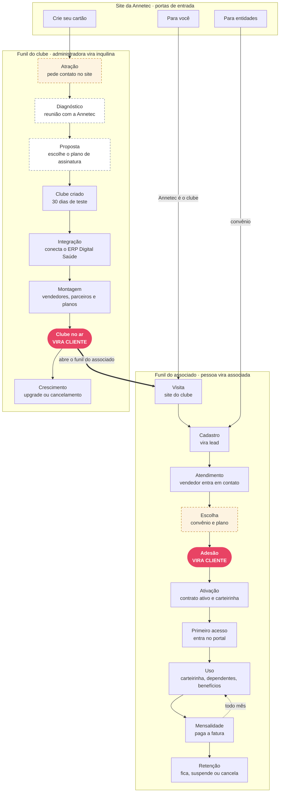
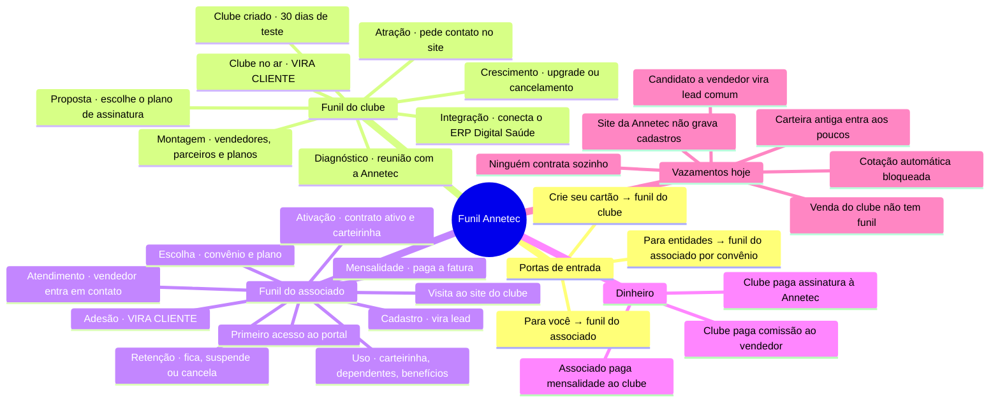

# Funil Annetec

Dois funis encaixados: **a Annetec vende o clube, o clube vende o plano.**

- **Funil do clube**: uma administradora contrata a Annetec e ganha o próprio clube de benefícios (vira inquilina da plataforma).
- **Funil do associado**: dentro de cada clube, uma pessoa se cadastra, escolhe o plano e vira associada. A venda direta da Annetec usa esse mesmo funil — a própria Annetec funciona como um clube.

Legenda das cores: **coral** = momento em que vira cliente · **amarelo tracejado** = vaza hoje · **cinza tracejado** = manual, fora do sistema.

Para editar e compartilhar: cole qualquer bloco abaixo em <https://mermaid.live> (grátis, sem login). O botão **Share** gera um link que já carrega o código. O GitHub também desenha estes blocos direto no arquivo `.md`.

## Fluxo

## Mapa mental

