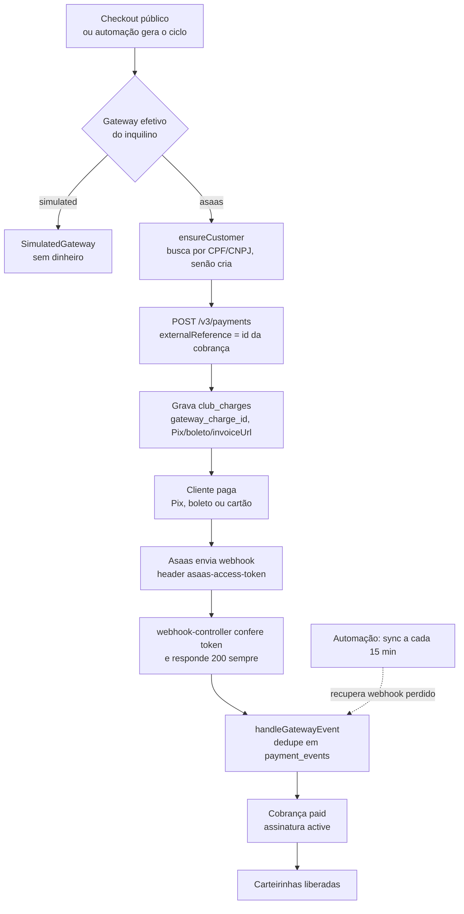
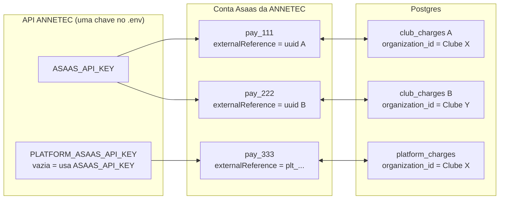

# Pagamentos com Asaas — configuração sandbox e produção

Guia para quem opera a API da ANNETEC e precisa ligar a cobrança real no Asaas,
primeiro na sandbox (teste) e depois em produção, para vários inquilinos ao mesmo tempo.

Convenções deste documento:

- Caminhos com linha (`arquivo.ts:40`) apontam para o código como está hoje.
- "No painel do Asaas..." indica conhecimento do Asaas, não do nosso código. Os nomes de menu do painel mudam com o tempo. Confira na documentação oficial (docs.asaas.com).
- Todos os comandos rodam na raiz do repositório, salvo indicação.

---

## 1. Visão geral: como o sistema cobra hoje

### Dois motores de cobrança

| Motor | Quem paga quem | Módulo | Tabelas | Webhook |
|---|---|---|---|---|
| **club-billing** | O associado paga o clube do inquilino (checkout, mensalidade, dependentes) | `apps/api/src/modules/club-billing/` | `billing_settings`, `club_subscriptions`, `club_charges`, `payment_events` (migração `0006`) | `POST /api/v1/webhooks/asaas` |
| **platform-billing** | A ANNETEC cobra o inquilino (ativação, mensalidade, ajustes) | `apps/api/src/modules/platform-billing/` | `tenant_plan_prices`, `platform_billing_settings`, `platform_subscriptions`, `platform_charges`, `platform_billing_events` (migração `0008`) | `POST /api/v1/webhooks/asaas-plataforma` |

Os dois usam o mesmo cliente HTTP (`apps/api/src/integrations/asaas/client.ts`) e a mesma classe `AsaasGateway` (`apps/api/src/integrations/asaas/gateway.ts:26`).
O ciclo da assinatura é nosso. O Asaas só cria, consulta, cancela, dá baixa e estorna cobranças (`gateway.ts:21-25`).

### Gateways disponíveis

| Gateway | Quando é usado | O que faz |
|---|---|---|
| `simulated` (padrão) | Sem configuração nenhuma | Pix/boleto/cartão de mentira, sem dinheiro. Pix compensa sozinho em 20 s, boleto em 120 s. Cartão com final `0002` é recusado (`apps/api/.env.example:61-66`). |
| `asaas` | `PAYMENT_GATEWAY=asaas` (ou override do inquilino) **e** `ASAAS_API_KEY` preenchida | Cobranças reais na API v3 do Asaas. Sandbox ou produção conforme `ASAAS_ENV`. |

URLs da API do Asaas (`client.ts:44-47`):

- produção: `https://api.asaas.com/v3`
- sandbox: `https://api-sandbox.asaas.com/v3`

Autenticação: header `access_token` com a chave, sem "Bearer", mais `User-Agent` (`client.ts:100-104`).

### Como cada inquilino escolhe o gateway

Ordem de decisão do clube (`apps/api/src/integrations/payments/provider.ts:56-66`):

1. `billing_settings.gateway` do inquilino (override gravado pela tela ou pela API).
2. Se for `null`, vale a env `PAYMENT_GATEWAY`.
3. Se o resultado for `asaas` mas não houver `ASAAS_API_KEY`, cai no `simulated` e loga um aviso uma vez por processo.

A plataforma segue a mesma lógica com `platform_billing_settings.gateway` → `PLATFORM_PAYMENT_GATEWAY` → `simulated` (`apps/api/src/modules/platform-billing/gateway.ts:48-58`).

Regra importante: **a cobrança segue no gateway em que nasceu**. Cada linha de `club_charges`/`platform_charges` grava `gateway_provider`. Trocar o gateway do inquilino só afeta as próximas cobranças (`provider.ts:20-22`, `provider.ts:74`).

### Fluxo de uma cobrança no Asaas



Detalhes do caminho:

- O `externalReference` da cobrança do clube é o `id` (uuid) da linha em `club_charges` (`apps/api/src/modules/club-billing/charges.service.ts:179`).
- O da plataforma é `plt_` + uuid sem hífens (`apps/api/src/modules/platform-billing/access-key.ts:35-44`). Assim um handler nunca confunde a cobrança do outro.
- Se o `POST /payments` der timeout ou 5xx, o gateway consulta por `externalReference` antes de qualquer repetição (`gateway.ts:96-106`). POST nunca é repetido automaticamente (`client.ts:107`).
- O webhook e a sincronização periódica chamam o mesmo handler (`apps/api/src/modules/club-billing/events.service.ts:135`).

### Vários inquilinos numa única conta Asaas



| Peça | Onde mora | Papel na separação |
|---|---|---|
| Chave de API | `.env` do servidor (uma só) | Todos os inquilinos usam a mesma conta Asaas |
| `externalReference` da cobrança | Asaas, igual a `club_charges.id` ou `plt_<id>` | Liga o pagamento à linha certa |
| `organization_id` | `club_charges`, `club_subscriptions`, `platform_charges` | Define de qual inquilino é a cobrança |
| `gateway_customer_id` | `club_subscriptions` e `platform_subscriptions` | Id do cliente no Asaas, por assinatura |
| `externalReference` do cliente | Asaas: `user.id` do associado (clube) ou `organization_id` (plataforma) | Só informativo (`charges.service.ts:110-118`) |

Atenção: o cliente no Asaas é buscado por CPF/CNPJ (`gateway.ts:40-44`). Se a mesma pessoa for associada de dois clubes, as duas assinaturas apontam para o **mesmo** cliente no Asaas.

---

## 2. Variáveis de ambiente

Arquivo: `apps/api/.env` (modelo em `apps/api/.env.example`). Validação em `apps/api/src/config/env.ts`. Variável presente mas vazia (`FOO=`) vale como ausente (`env.ts:11-14`). Booleanos aceitam `true/false/1/0/yes/no/on/off/sim/não` (`env.ts:20-27`).

### Tabela completa

| Variável | Para quê | Valor sandbox | Valor produção | Obrigatória? |
|---|---|---|---|---|
| `NODE_ENV` | Liga as regras de produção (webhook sem token = 401, automação e atalhos de demo desligados por padrão) | `development` | `production` | Sim em produção |
| `PAYMENT_GATEWAY` | Gateway padrão do clube (`env.ts:61`) | `asaas` (ou `simulated` e override por inquilino) | `asaas` (ou override por inquilino) | Não. Padrão `simulated` |
| `ASAAS_API_KEY` | Chave da conta Asaas usada pelo clube e, por fallback, pela plataforma (`env.ts:63`, mín. 10 caracteres) | `$aact_hmlg_...` | `$aact_prod_...` | Sim para usar Asaas |
| `ASAAS_ENV` | Escolhe a URL base (`env.ts:64`). Vale para as duas chaves | `sandbox` | `production` | Não. Padrão `sandbox` |
| `ASAAS_WEBHOOK_TOKEN` | Token conferido no header `asaas-access-token` do webhook do clube (`env.ts:66`) | Gerado, 64 hex | Gerado, 64 hex, diferente do sandbox | Sim em produção (sem ele: 401) |
| `ASAAS_USER_AGENT` | `User-Agent` exigido pelo Asaas em contas novas (`env.ts:68`) | `ANNETEC-Clube/1.0` | `ANNETEC-Clube/1.0` | Não. Tem padrão |
| `ASAAS_TIMEOUT_MS` | Timeout de cada chamada ao Asaas (`env.ts:69`) | `20000` | `20000` | Não. Padrão `20000` |
| `SIMULATED_PIX_APPROVE_SECONDS` | Segundos até o Pix simulado compensar; `0` = só pelo botão (`env.ts:71`) | `20` | irrelevante com Asaas | Não |
| `SIMULATED_BOLETO_APPROVE_SECONDS` | Idem para boleto simulado (`env.ts:73`) | `120` | irrelevante com Asaas | Não |
| `SIMULATED_PIX_KEY` | Chave Pix fictícia do BR Code simulado (`env.ts:75-78`) | padrão | irrelevante com Asaas | Não |
| `BILLING_AUTOMATION_ENABLED` | Liga o timer da automação do clube (`env.ts:80`, regra em `env.ts:155`) | `true` | `true` em servidor persistente; na Vercel não tem efeito | Não. Padrão: ligado fora de produção, **desligado em produção** |
| `BILLING_AUTOMATION_INTERVAL_SECONDS` | Intervalo do timer do clube (`env.ts:81-84`, mín. 10) | `60` | `60` | Não. Padrão `60` |
| `WEB_BASE_URL` | Base dos links montados pela API: boleto simulado e página pública da fatura da plataforma, usada nos e-mails (`env.ts:86`, `env.ts:158`, `access-key.ts:30-33`) | `http://localhost:3000` | `https://<web de produção>` | Recomendada. Padrão: 1ª origem de `CORS_ORIGINS` |
| `PLATFORM_PAYMENT_GATEWAY` | Gateway padrão da cobrança ANNETEC → inquilino (`env.ts:95`) | `asaas` | `asaas` | Não. Padrão `simulated` |
| `PLATFORM_ASAAS_API_KEY` | Chave de uma conta Asaas só para a plataforma (`env.ts:97`) | vazio ou `$aact_hmlg_...` | vazio ou `$aact_prod_...` | Não. Vazio = `ASAAS_API_KEY` |
| `PLATFORM_ASAAS_WEBHOOK_TOKEN` | Token do webhook `/asaas-plataforma` (`env.ts:99`) | vazio ou gerado | gerado (recomendado separado) | Não. Vazio = `ASAAS_WEBHOOK_TOKEN` |
| `PLATFORM_BILLING_AUTOMATION_ENABLED` | Liga o timer da automação da plataforma (`env.ts:101`, regra em `env.ts:161`) | vazio | `true` em servidor persistente | Não. Vazio = segue `BILLING_AUTOMATION_ENABLED` |
| `PLATFORM_BILLING_AUTOMATION_INTERVAL_SECONDS` | Intervalo do timer da plataforma (`env.ts:102-104`) | `60` | `60` | Não. Padrão `60` |
| `PLATFORM_MERCHANT_NAME` | Recebedor no Pix/boleto **simulado** da plataforma (`env.ts:107`) | `ANNETEC` | irrelevante com Asaas | Não |
| `PLATFORM_MERCHANT_CITY` | Cidade no Pix simulado da plataforma (`env.ts:108`) | `Rio de Janeiro` | irrelevante com Asaas | Não |
| `PLATFORM_DEMO_TOOLS_ENABLED` | Atalho "avançar N dias" do console (`env.ts:110`, `env.ts:164`). Só funciona com o gateway da plataforma em `simulated` (`apps/api/src/modules/platform-billing/settings.service.ts:87-90`) | vazio | `false` | Não. Vazio = ligado fora de produção |

Variáveis que a cobrança também usa, já existentes: `API_BASE_URL` (URL pública da API), `CORS_ORIGINS`, `BETTER_AUTH_SECRET` (assina a chave das páginas públicas de fatura, `access-key.ts:14-19`), `EMAIL_PROVIDER` (e-mails da cobrança da plataforma).

### Bloco `.env` — sandbox

```dotenv
NODE_ENV=development
API_BASE_URL=http://localhost:3333
CORS_ORIGINS=http://localhost:3000
WEB_BASE_URL=http://localhost:3000

# Clube (associado -> inquilino)
PAYMENT_GATEWAY=asaas
ASAAS_API_KEY=$aact_hmlg_COLE_A_CHAVE_DA_SANDBOX_AQUI
ASAAS_ENV=sandbox
ASAAS_WEBHOOK_TOKEN=COLE_O_TOKEN_GERADO_AQUI_64_HEX
ASAAS_USER_AGENT=ANNETEC-Clube/1.0
ASAAS_TIMEOUT_MS=20000

BILLING_AUTOMATION_ENABLED=true
BILLING_AUTOMATION_INTERVAL_SECONDS=60

# Plataforma (ANNETEC -> inquilino). Vazio = usa as do clube.
PLATFORM_PAYMENT_GATEWAY=asaas
PLATFORM_ASAAS_API_KEY=
PLATFORM_ASAAS_WEBHOOK_TOKEN=
PLATFORM_BILLING_AUTOMATION_ENABLED=
PLATFORM_BILLING_AUTOMATION_INTERVAL_SECONDS=60
PLATFORM_MERCHANT_NAME=ANNETEC
PLATFORM_MERCHANT_CITY=Rio de Janeiro
PLATFORM_DEMO_TOOLS_ENABLED=
```

Obs.: em alguns shells o `$` da chave é interpretado. No arquivo `.env` lido pelo `dotenv` não há problema. Em painel de hospedagem, cole a chave como está.

### Bloco `.env` — produção

```dotenv
NODE_ENV=production
API_BASE_URL=https://api.SEU-DOMINIO.com.br
CORS_ORIGINS=https://app.SEU-DOMINIO.com.br
WEB_BASE_URL=https://app.SEU-DOMINIO.com.br

# Clube (associado -> inquilino)
PAYMENT_GATEWAY=asaas
ASAAS_API_KEY=$aact_prod_COLE_A_CHAVE_DE_PRODUCAO_AQUI
ASAAS_ENV=production
ASAAS_WEBHOOK_TOKEN=COLE_UM_TOKEN_NOVO_64_HEX
ASAAS_USER_AGENT=ANNETEC-Clube/1.0
ASAAS_TIMEOUT_MS=20000

# Em servidor persistente (Railway/Render/VM): ligue. Na Vercel não há timer (ver seção 6).
BILLING_AUTOMATION_ENABLED=true
BILLING_AUTOMATION_INTERVAL_SECONDS=60

# Plataforma (ANNETEC -> inquilino)
PLATFORM_PAYMENT_GATEWAY=asaas
PLATFORM_ASAAS_API_KEY=
PLATFORM_ASAAS_WEBHOOK_TOKEN=COLE_OUTRO_TOKEN_64_HEX
PLATFORM_BILLING_AUTOMATION_ENABLED=true
PLATFORM_BILLING_AUTOMATION_INTERVAL_SECONDS=60
PLATFORM_DEMO_TOOLS_ENABLED=false
```

### Regra de fallback e chave compartilhada

- `PLATFORM_ASAAS_API_KEY` vazia → a plataforma usa `ASAAS_API_KEY` (`platform-billing/gateway.ts:34-36`).
- `PLATFORM_ASAAS_WEBHOOK_TOKEN` vazio → usa `ASAAS_WEBHOOK_TOKEN` (`platform-billing/gateway.ts:43-45`).
- `PLATFORM_BILLING_AUTOMATION_ENABLED` vazio → segue a do clube (`env.ts:161`).
- A chave do clube é **uma só para todos os inquilinos**. Não existe chave por inquilino (`provider.ts:74-92` cria um único `AsaasGateway` por processo).

### Duas contas Asaas (clube e plataforma separados)

Dá para usar uma conta Asaas para o dinheiro dos clubes e outra para o faturamento da ANNETEC:

- `ASAAS_API_KEY` = chave da conta "clubes".
- `PLATFORM_ASAAS_API_KEY` = chave da conta "ANNETEC".
- Cada webhook é cadastrado na conta correspondente.

Limite: `ASAAS_ENV`, `ASAAS_USER_AGENT` e `ASAAS_TIMEOUT_MS` são compartilhados (`platform-billing/gateway.ts:201-209`). As duas contas precisam estar no **mesmo ambiente** (as duas sandbox ou as duas produção).

---

## 3. Passo a passo: conta sandbox (teste)

### Pré-requisitos

- Node >= 22 e pnpm 10 (`package.json` da raiz).
- Banco migrado: `pnpm db:migrate`.
- `jq` instalado, para os exemplos de `curl`.

### 1. Criar a conta sandbox

No painel do Asaas: acesse `https://sandbox.asaas.com` e crie uma conta. A sandbox não movimenta dinheiro e não exige aprovação de documentos para testar.

### 2. Gerar a chave de API

No painel do Asaas (sandbox): menu de Integrações → Chaves de API → gerar chave. A chave da sandbox começa com `$aact_hmlg_`. Copie na hora; o Asaas só mostra uma vez.

### 3. Gerar o token do webhook

O código aceita de 1 a 255 caracteres (`env.ts:66`). O `.env.example` registra a regra do Asaas de 32 a 255 (`apps/api/.env.example:53`). Use 64 caracteres hex:

```bash
openssl rand -hex 32
# ou
node -e "console.log(require('crypto').randomBytes(32).toString('hex'))"
```

Gere um para `ASAAS_WEBHOOK_TOKEN`. Se quiser separar a plataforma, gere outro para `PLATFORM_ASAAS_WEBHOOK_TOKEN`.

### 4. Preencher o `.env`

Copie `apps/api/.env.example` para `apps/api/.env` e use o bloco sandbox da seção 2.

### 5. Subir a API

```bash
pnpm install
pnpm db:migrate
pnpm dev:api        # só a API (tsx watch src/index.ts) na porta 3333
# ou
pnpm dev            # API + web em paralelo
```

No log, confira:

- `Automação de cobrança do clube agendada` (primeira rodada 10 s após o boot, `apps/api/src/modules/club-billing/automation.service.ts:497-502`).
- Nenhum aviso `PAYMENT_GATEWAY=asaas sem ASAAS_API_KEY` (`provider.ts:61`). Se aparecer, a chave não foi lida.

### 6. Expor a API local para o webhook

O Asaas precisa alcançar sua máquina. Use um túnel:

```bash
ngrok http 3333
# ou
cloudflared tunnel --url http://localhost:3333
```

Anote a URL pública, por exemplo `https://abc123.ngrok-free.app`. Ela muda a cada execução do túnel gratuito; quando mudar, rode o `asaas:setup` de novo (passo 7), que atualiza a URL dos webhooks já cadastrados.

Teste o token antes de cadastrar no Asaas:

```bash
TUNNEL=https://abc123.ngrok-free.app
TOKEN_WH=COLE_O_ASAAS_WEBHOOK_TOKEN

# Token certo: 200 {"success":true,"data":{"received":true}}
curl -i -X POST "$TUNNEL/api/v1/webhooks/asaas" \
  -H "asaas-access-token: $TOKEN_WH" -H 'content-type: application/json' \
  -d '{"id":"evt_teste_1","event":"PAYMENT_RECEIVED","payment":{"id":"pay_inexistente"}}'

# Token errado: 401
curl -i -X POST "$TUNNEL/api/v1/webhooks/asaas" \
  -H "asaas-access-token: errado" -H 'content-type: application/json' -d '{}'
```

O primeiro chega como "sem cobrança correspondente — ignorado" no log (`events.service.ts:141-146`), o que é esperado.

### 7. Cadastrar os DOIS webhooks e a chave Pix (script)

Com a chave em `ASAAS_API_KEY` e o túnel no ar, rode na raiz do repositório:

```bash
pnpm --filter @annetec/api asaas:setup --public-url https://abc123.ngrok-free.app --pix-key
# conferir antes, sem criar nem alterar nada:
pnpm --filter @annetec/api asaas:setup --public-url https://abc123.ngrok-free.app --pix-key --dry-run
```

O script (`apps/api/scripts/asaas-setup.ts`) é idempotente:

1. Valida a chave em `GET /v3/myAccount/commercialInfo/` e mostra nome, e-mail e situação da conta. Chave recusada, ou prefixo `$aact_prod_` com `ASAAS_ENV=sandbox` (e o contrário), param o script com erro.
2. Lista os webhooks da conta (`GET /v3/webhooks`). Se já existir um com a mesma URL, ou com o mesmo nome (o túnel mudou), atualiza com `PUT /v3/webhooks/{id}`; senão cria com `POST /v3/webhooks`. Nunca duplica.
3. Cadastra os dois webhooks da tabela abaixo: ativos, fila não interrompida, v3, envio sequencial, os 7 eventos e o token do `.env`. Se `PLATFORM_ASAAS_API_KEY` for outra chave, o webhook da plataforma vai na conta da plataforma.
4. Com `--pix-key`, cria uma chave Pix aleatória (EVP) se a conta não tiver nenhuma ativa ou aguardando ativação (`/v3/pix/addressKeys`). Sem chave Pix a sandbox não gera QR Code.
5. Imprime um resumo e sai com código 1 em qualquer erro. Chave e token nunca aparecem inteiros.

Outras opções: `--email ops@seudominio` (e-mail que o Asaas avisa quando o webhook falha; padrão: e-mail da conta). Sem `--public-url`, o script usa `API_BASE_URL`, desde que não seja `localhost`. Se `ASAAS_WEBHOOK_TOKEN` estiver vazio, o script gera um, imprime e para: grave o valor no `.env`, reinicie a API e rode de novo. O script nunca escreve no `.env`.

**Alternativa manual.** No painel do Asaas (sandbox): Integrações → Webhooks → Adicionar. Cadastre dois:

| Campo no painel | Webhook do clube | Webhook da plataforma |
|---|---|---|
| Nome | `ANNETEC clube` | `ANNETEC plataforma` |
| URL | `https://<túnel>/api/v1/webhooks/asaas` | `https://<túnel>/api/v1/webhooks/asaas-plataforma` |
| Token de autenticação | valor de `ASAAS_WEBHOOK_TOKEN` | valor de `PLATFORM_ASAAS_WEBHOOK_TOKEN` (ou o mesmo do clube, se vazio) |
| Versão da API | v3 | v3 |
| Tipo de envio | Sequencial | Sequencial |
| Fila de sincronização | Ativada | Ativada |
| Webhook ativo | Sim | Sim |
| E-mail de erro | e-mail técnico da equipe | idem |

O Asaas envia o token no header `asaas-access-token`. A API compara em tempo constante, com SHA-256 dos dois lados (`apps/api/src/integrations/asaas/webhook.ts:20-26`).

Eventos a marcar (os 7 que o código trata, `events.service.ts:210-222` e `platform-billing/events.service.ts:437-447`):

| Evento | Efeito no sistema |
|---|---|
| `PAYMENT_CONFIRMED` | Cobrança `paid`; ativa/reativa a assinatura |
| `PAYMENT_RECEIVED` | Cobrança `paid` (mesmo efeito; aplicado uma vez só) |
| `PAYMENT_OVERDUE` | Cobrança `overdue` |
| `PAYMENT_CREDIT_CARD_CAPTURE_REFUSED` | Cobrança `failed` |
| `PAYMENT_REPROVED_BY_RISK_ANALYSIS` | Cobrança `failed` |
| `PAYMENT_REFUNDED` | Cobrança `refunded` |
| `PAYMENT_DELETED` | Cobrança `canceled` |

Outros eventos são gravados na timeline mas não mudam estado. Não há prejuízo em marcá-los, mas não há ganho.

Por que dois webhooks na mesma conta funcionam: cada URL recebe todos os eventos da conta. O handler do clube ignora o `externalReference` `plt_...` (não é uuid) e não acha a cobrança pelo `gateway_charge_id`. O da plataforma faz o inverso. Os dois respondem 200 e seguem (`events.service.ts:180-201`, `platform-billing/events.service.ts:402-425`).

### 8. Ativar o Asaas para um inquilino

Se `PAYMENT_GATEWAY=asaas`, todo inquilino sem override já usa o Asaas. Para ativar só um:

**Pela tela:** `/<slug>/admin/faturamento` → aba **Automação** → campo **Gateway deste clube** → Asaas → salvar. O cartão "Gateway e automação" mostra se a chave está configurada e se é sandbox (`apps/web/components/admin/faturamento/automation-panel.tsx:223-247`).

**Pela API:** a API só aceita `Authorization: Bearer <token>`; o token vem do login (`apps/api/src/modules/auth/controller.ts:16-29`).

```bash
API=http://localhost:3333
SLUG=mapcard2

TOKEN=$(curl -s -X POST "$API/api/v1/auth/login" \
  -H 'content-type: application/json' \
  -d '{"email":"admin@seuclube.com.br","password":"SENHA"}' | jq -r '.data.token')

# Grava o override. O campo é gatewayOverride; null volta a seguir PAYMENT_GATEWAY.
curl -s -X PATCH "$API/api/v1/t/$SLUG/faturamento/configuracoes" \
  -H "authorization: Bearer $TOKEN" -H 'content-type: application/json' \
  -d '{"gatewayOverride":"asaas"}' | jq '.data | {gateway, gatewayOverride, asaasConfigured, sandbox}'
```

Esperado: `gateway: "asaas"`, `asaasConfigured: true`, `sandbox: true`. Se o servidor estiver sem chave, a API recusa com "O Asaas ainda não está configurado no servidor" (`apps/api/src/modules/club-billing/settings.service.ts:134-136`).

As rotas `/faturamento/*` exigem admin do inquilino ou sessão da equipe ANNETEC (`apps/api/src/modules/club-billing/admin-controller.ts:61`, `apps/api/src/http/middleware/auth.ts:55-59`).

### 9. Fazer um checkout de teste

Abra `http://localhost:3000/<slug>/assinar` em janela anônima e siga o checkout. Meios:

| Meio | O que acontece na sandbox |
|---|---|
| Pix | QR e copia-e-cola reais da sandbox (`gateway.ts:170-177`). Se o QR não vier, falta chave Pix na conta: rode o `asaas:setup` com `--pix-key` (passo 7) ou cadastre uma chave aleatória no painel. |
| Boleto | Linha digitável e link do boleto da sandbox (`gateway.ts:178-185`). |
| Cartão | Captura na criação. Recusa vira `CardDeclinedError` e a cobrança não é criada (`client.ts:151-155`). |

Cartões da sandbox (`packages/contracts/src/annetec/club-billing.ts:416-421`):

| Número | Resultado |
|---|---|
| `4444 4444 4444 4444` | Aprovado (aceito mesmo sem passar no Luhn) |
| `5184 0197 4037 3151` | Recusado |
| `4916 5613 5824 0741` | Recusado |

CVV: qualquer 3 dígitos. Validade: qualquer data futura. O checkout também pede CPF, CEP e número do endereço do titular, que o Asaas exige em `creditCardHolderInfo` (`gateway.ts:77-84`).

O número do cartão e o CVV passam pela API até o Asaas. Só o token, bandeira, finais e validade ficam gravados (`club_subscriptions.card_token`, `apps/api/src/db/schema/club-billing.ts:124-125`).

### 10. Confirmar o pagamento

Três jeitos, do mais simples ao mais real:

1. **Botão "Simular pagamento"** na tela do checkout ou no painel de faturamento. Só aparece com gateway simulado ou Asaas sandbox (`apps/web/lib/adapters/faturamento.ts:124-127`). No Asaas, chama `POST /v3/sandbox/payment/{id}/confirm` e sincroniza na hora (`charges.service.ts:596-622`, `client.ts:233-237`).
2. **Pela API:**

   ```bash
   # Lista cobranças do inquilino e pega o id
   curl -s "$API/api/v1/t/$SLUG/faturamento/cobrancas" -H "authorization: Bearer $TOKEN" | jq '.data[0]'

   CHARGE_ID=cole-o-id
   curl -s -X POST "$API/api/v1/t/$SLUG/faturamento/cobrancas/$CHARGE_ID/simular-pagamento" \
     -H "authorization: Bearer $TOKEN" | jq '.data.status'
   ```

3. **No painel do Asaas (sandbox):** abra a cobrança e use a opção de confirmar pagamento. Isso gera o webhook de verdade.

Com o jeito 1 ou 2 a baixa acontece pela sincronização. O webhook chega depois e é marcado como duplicado ou "registrado" sem mudar nada, por causa da idempotência (`events.service.ts:36-43`).

### 11. Conferir o webhook e a assinatura

```bash
# Timeline de eventos do inquilino (origem: webhook, automação, checkout, equipe)
curl -s "$API/api/v1/t/$SLUG/faturamento/eventos" -H "authorization: Bearer $TOKEN" \
  | jq '.data[] | {type, source, message}'

# Assinaturas
curl -s "$API/api/v1/t/$SLUG/faturamento/assinaturas" -H "authorization: Bearer $TOKEN" \
  | jq '.data[] | {id, status}'
```

Esperado: um evento `PAYMENT_CONFIRMED` ou `PAYMENT_RECEIVED` com origem `webhook`, assinatura `active` e carteirinhas visíveis em `/<slug>/cliente/carteirinha`.

No painel do Asaas, a tela do webhook mostra cada entrega e o status HTTP devolvido. Tem que ser 200.

### 12. Testar a cobrança da plataforma

1. Login como superadmin (seed: `super@annetec.com.br`, ver `docs/apresentacao/roteiro-demo-clube.md`).
2. `/admin/financeiro` → aba **Régua e automação** → **Gateway da plataforma** → Asaas (só o superadmin grava, `apps/api/src/modules/platform-billing/admin-controller.ts:184`).
3. Gere uma fatura: segunda via de uma fatura existente, ou "Executar automação agora" com uma assinatura perto do vencimento. Dados de demo: `pnpm --filter @annetec/api demo:plataforma`.
4. Pague pela página pública `/fatura-annetec/<id>?chave=...` ou use "Simular pagamento".
5. Confira em `GET /api/v1/platform/billing/eventos`.

### 13. Rodar os testes da integração

```bash
pnpm test:api
```

`apps/api/tests/club-billing-asaas.test.ts` cobre o cliente (header, GET sem corpo, retry só em GET, 400 de cartão, 401), o gateway (Pix, cartão, recuperação por `externalReference`) e o token do webhook. Usa `fetch` falso; não chama o Asaas.

---

## 4. Passo a passo: conta produção

### Pré-requisitos

- Conta Asaas de produção **aprovada**. No painel do Asaas: envio de documentos da empresa e análise cadastral. Sem aprovação o Asaas pode recusar operações (a API devolve 403, ver `client.ts:172-179`).
- Chave de produção, prefixo `$aact_prod_`.
- **Banco de produção separado** do banco onde você testou a sandbox. O banco não registra em qual ambiente/conta a cobrança nasceu, só `gateway_provider = 'asaas'`. Cobranças, clientes e tokens de cartão da sandbox não existem na produção.
- API publicada com URL HTTPS pública e estável.

### Passos

1. **Variáveis.** Use o bloco de produção da seção 2. Pontos obrigatórios:
   - `NODE_ENV=production`.
   - `ASAAS_ENV=production`.
   - `ASAAS_WEBHOOK_TOKEN` preenchido. Em produção, sem token, os dois webhooks respondem 401 a qualquer chamada (`apps/api/src/modules/club-billing/webhook-controller.ts:26-27`, `apps/api/src/modules/platform-billing/webhook-controller.ts:26-27`).
   - Tokens **novos**, diferentes dos da sandbox.
2. **Webhooks.** Com as variáveis de produção carregadas (`ASAAS_ENV=production`, chave `$aact_prod_`, tokens novos), rode o script da seção 3, passo 7, com a URL de produção:

   ```bash
   pnpm --filter @annetec/api asaas:setup --public-url https://api.SEU-DOMINIO.com.br --dry-run   # confere
   pnpm --filter @annetec/api asaas:setup --public-url https://api.SEU-DOMINIO.com.br             # aplica
   ```

   - Cadastra `https://api.SEU-DOMINIO.com.br/api/v1/webhooks/asaas` e `https://api.SEU-DOMINIO.com.br/api/v1/webhooks/asaas-plataforma`.
   - Se usar duas contas (`PLATFORM_ASAAS_API_KEY` diferente), cada webhook vai na sua conta.
   - `--pix-key` também funciona em produção, mas o Asaas só cria chave Pix em conta aprovada. Se recusar, cadastre a chave pelo painel.
   - O script lê `apps/api/.env`. Rode onde as variáveis de produção estejam disponíveis (no servidor, ou localmente com elas exportadas no shell; variável do ambiente vence o `.env`).
   - Alternativa manual: cadastre os dois webhooks no painel do Asaas de produção com os mesmos campos da tabela da seção 3, passo 7.
3. **Gateway padrão.** Escolha uma estratégia:
   - `PAYMENT_GATEWAY=asaas`: todo inquilino sem override cobra no Asaas.
   - `PAYMENT_GATEWAY=simulated` e override `asaas` só nos inquilinos já liberados (tela ou `PATCH /configuracoes`).
4. **Automação.** Em produção o padrão é **desligado** (`env.ts:155`).
   - Servidor persistente (Railway, Render, VM com `pnpm --filter @annetec/api start`): defina `BILLING_AUTOMATION_ENABLED=true` e `PLATFORM_BILLING_AUTOMATION_ENABLED=true`. Os timers sobem em `apps/api/src/index.ts:16` e `apps/api/src/index.ts:22`.
   - **Vercel:** o ponto de entrada é `apps/api/src/vercel.ts`, que não chama os `start*Automation`. Não há timer, qualquer que seja a env. É preciso um cron externo chamando `POST .../automacao/executar` (seção 6). Sem isso nenhum ciclo novo é gerado, nada vence e nada é suspenso.
5. **Atalhos de demo.** `PLATFORM_DEMO_TOOLS_ENABLED=false`. Com gateway da plataforma em Asaas o atalho já fica bloqueado (`platform-billing/settings.service.ts:87-90`), mas deixe explícito.
6. **Teste de fumaça.** Com um inquilino interno, faça uma assinatura real de valor baixo via Pix. Confira o webhook 200 no painel do Asaas e o evento em `/faturamento/eventos`. Estorne pelo painel do Asaas; o `PAYMENT_REFUNDED` deve marcar a cobrança como `refunded`.

### Rotação de chaves

**Mesma conta Asaas, chave nova** (caso normal):

1. No painel do Asaas, gere a nova chave.
2. Troque `ASAAS_API_KEY` (e/ou `PLATFORM_ASAAS_API_KEY`) no ambiente.
3. Reinicie a API. O `AsaasGateway` fica em cache no processo (`provider.ts:82`, `platform-billing/gateway.ts:201`); só pega a chave nova no boot.
4. Teste uma consulta (abra uma cobrança no painel de faturamento).
5. Só então desative a chave antiga no painel do Asaas.

Nada quebra: os ids de cobrança, clientes e tokens de cartão pertencem à conta, não à chave.

**Token do webhook:** troque no `.env` e rode `asaas:setup` (ou edite no painel do Asaas) quase ao mesmo tempo. Entre uma troca e outra, as entregas recebem 401 e se acumulam na fila do Asaas. A sincronização de 15 min cobre o intervalo.

**Outra conta Asaas** (trocar de conta): **não faça com cobranças abertas.** O código não lida com isso:

- Cobranças antigas continuam com `gateway_provider = 'asaas'` e o sync passa a receber 404 da conta nova.
- A assinatura reaproveita o `gateway_customer_id` gravado (`charges.service.ts:111`). A busca por CPF/CNPJ só acontece quando esse campo está vazio. Na conta nova, esse id não existe e a criação da cobrança falha.
- Tokens de cartão salvos não valem na conta nova.

Se precisar migrar de conta, limpe `gateway_customer_id` e `card_token` das assinaturas afetadas e encerre as cobranças abertas antes.

### Limites do Asaas que o código já respeita

| Proteção | Onde |
|---|---|
| Sync de cobranças Asaas no máximo a cada 15 min por cobrança (simulado: 30 s). Comentário cita o limite de 25 mil requisições em 12 h | `automation.service.ts:44-45`, `platform-billing/automation.service.ts:59` |
| Até 200 cobranças sincronizadas por inquilino por rodada | `automation.service.ts:43` |
| GET repetido até 3× em falha de rede, 429 e 5xx; espera 1,5 s após 429 | `client.ts:68-69`, `client.ts:192-193` |
| POST/DELETE nunca repetidos | `client.ts:107` |
| GET sem corpo (corpo em GET dá 403 no Asaas) | `client.ts:35`, `client.ts:99` |
| Cliente reaproveitado por CPF/CNPJ (sem duplicar no painel) | `gateway.ts:40-44` |
| Cliente criado com `notificationDisabled: true` (Asaas não manda e-mail/SMS ao pagador) | `gateway.ts:51` |

### Checklist de go-live

- [ ] Conta Asaas de produção aprovada.
- [ ] Banco de produção sem dados da sandbox.
- [ ] `NODE_ENV=production` e `ASAAS_ENV=production`.
- [ ] `ASAAS_API_KEY` com prefixo `$aact_prod_`.
- [ ] `ASAAS_WEBHOOK_TOKEN` novo (64 hex) e, se separado, `PLATFORM_ASAAS_WEBHOOK_TOKEN`.
- [ ] `WEB_BASE_URL` e `API_BASE_URL` com os domínios de produção.
- [ ] Webhook `/api/v1/webhooks/asaas` cadastrado, ativo, v3, sequencial, 7 eventos, token conferido.
- [ ] Webhook `/api/v1/webhooks/asaas-plataforma` cadastrado nas mesmas condições.
- [ ] Teste com `curl` do token: certo = 200, errado = 401.
- [ ] Gateway padrão ou override por inquilino definido.
- [ ] Gateway da plataforma definido (env ou tela "Régua e automação").
- [ ] Automação ligada (servidor persistente) **ou** cron externo configurado (Vercel).
- [ ] `PLATFORM_DEMO_TOOLS_ENABLED=false`.
- [ ] `EMAIL_PROVIDER` real (`resend` ou `sendgrid`) para os e-mails da cobrança da plataforma.
- [ ] Transação real de valor baixo paga, webhook 200 e evento na timeline.
- [ ] Estorno de teste pelo painel do Asaas refletido como `refunded`.
- [ ] Rotina de repasse aos inquilinos definida (seção 5).

---

## 5. Múltiplos inquilinos: como funciona hoje e limites

### O que existe hoje

- **Não há** subconta, split, `walletId` nem chave por inquilino. Nenhum desses termos aparece no código da integração.
- **Todo recebimento cai na conta Asaas única da ANNETEC** (ou na conta indicada em `ASAAS_API_KEY`).
- A separação é **lógica**, no nosso banco:
  - `organization_id` em `club_subscriptions` e `club_charges`;
  - `externalReference` da cobrança no Asaas = `club_charges.id`;
  - lock em processo por inquilino na automação (`automation.service.ts:47`, `automation.service.ts:58-75`).
- O inquilino escolhe apenas **o gateway** (`simulated` ou `asaas`), não a conta.
- **O repasse ao inquilino é feito fora do sistema.** Não há rota, tabela nem relatório de repasse.
- `revenue_share_percent` (`apps/api/src/db/schema/platform-billing.ts:61` e `:111`) é um percentual usado no cálculo da fatura que a ANNETEC emite ao inquilino. **Não** é split no gateway.

Consequências práticas:

| Situação | Efeito |
|---|---|
| Associado paga o clube X | Dinheiro entra no saldo Asaas da ANNETEC |
| Mesmo CPF associado a dois clubes | Um só cliente no Asaas para as duas assinaturas |
| Estorno | Feito no painel do Asaas da ANNETEC (não há rota de estorno) |
| Extrato por inquilino | Só pelo nosso banco (`club_charges` por `organization_id`) |

### Se precisar que cada inquilino receba na própria conta Asaas

No Asaas existem dois caminhos. Os dois exigem mudanças de código. Nada disto está implementado.

**Opção A — subcontas (e white label).** No Asaas, a conta raiz cria subcontas por `POST /v3/accounts`. A resposta traz a `apiKey` e o `walletId` da subconta. Cada inquilino passa a ter a própria conta, saldo e saque. White label (subconta sem acesso ao painel do Asaas) depende de liberação comercial do Asaas.

**Opção B — split.** A cobrança continua na conta da ANNETEC e leva no payload um array `split` com `walletId` do inquilino e `percentualValue` ou `fixedValue`. O Asaas divide o valor na liquidação. O inquilino precisa ter um `walletId` (conta própria ou subconta).

| Critério | A: subconta + chave por inquilino | B: split por `walletId` |
|---|---|---|
| Onde a cobrança nasce | Na conta do inquilino | Na conta da ANNETEC |
| Chaves no servidor | Uma por inquilino (cifrada) | Uma só |
| Webhooks | Um por subconta | Os dois de hoje |
| Comissão ANNETEC | Cobrada à parte (platform-billing) | Pode ficar no próprio split |
| Mudança de código | Maior | Menor |

O que mudaria no código:

| Arquivo / tabela | Mudança (A = subconta, B = split) |
|---|---|
| Nova tabela ou colunas em `billing_settings` | A: `asaas_account_id`, `asaas_api_key` cifrada (mesmo padrão de `tenant_integrations`), `wallet_id`. B: só `wallet_id` e regra de percentual. |
| `apps/api/src/integrations/asaas/client.ts` | A: `accounts.create` (`POST /accounts`). B: nada além dos tipos. |
| `apps/api/src/integrations/asaas/types.ts` | B: campo `split` em `AsaasCreatePaymentInput`. A: tipos de `/accounts`. |
| `apps/api/src/integrations/asaas/gateway.ts` | B: montar `split` em `createCharge` (`gateway.ts:57-66`). |
| `apps/api/src/integrations/payments/provider.ts` | A: trocar o `asaasGateway` único (`provider.ts:28`, `:82-90`) por cache por `orgId` com a chave do inquilino. |
| `apps/api/src/modules/club-billing/webhook-controller.ts` | A: identificar o inquilino (URL com slug ou token por subconta) e conferir o token certo. |
| `apps/api/src/modules/club-billing/automation.service.ts` | A: sync usa a chave do inquilino (já roda por inquilino). |
| `club_subscriptions.gateway_customer_id` / `card_token` | A: passam a valer só na subconta; migração de assinaturas existentes. |
| `apps/api/src/modules/platform-onboarding/` | A: criar a subconta no provisionamento, com os dados do KYB já coletados. |
| `tenant_plan_prices.revenue_share_percent` | B: pode virar o percentual retido no split. |
| Telas `/<slug>/admin/faturamento` e `/admin/inquilinos/[id]` | Mostrar status da conta/wallet do inquilino. |

---

## 6. Automação

### O que já roda sozinho

Em servidor persistente, dois timers sobem no boot (`apps/api/src/index.ts:14-22`):

| Motor | Função | Primeira rodada | Intervalo | Liga/desliga |
|---|---|---|---|---|
| Clube | `startBillingAutomation` (`automation.service.ts:458`) | 10 s após o boot | `BILLING_AUTOMATION_INTERVAL_SECONDS` (60) | `BILLING_AUTOMATION_ENABLED` |
| Plataforma | `startPlatformBillingAutomation` (`platform-billing/automation.service.ts:738`) | 15 s após o boot | `PLATFORM_BILLING_AUTOMATION_INTERVAL_SECONDS` (60) | `PLATFORM_BILLING_AUTOMATION_ENABLED` |

Os dois têm mutex em processo: uma rodada não começa se a anterior ainda roda. Erro de um inquilino não derruba os outros (`automation.service.ts:36-41`).

Passos da rodada do clube, por inquilino (`automation.service.ts:116-429`):

| Passo | O que faz | Padrão em `billing_settings` |
|---|---|---|
| sincronizar | Consulta no gateway as cobranças abertas não sincronizadas há 15 min (Asaas) | — |
| checkout abandonado | Encerra checkout sem pagamento há mais de 7 dias (`automation.rules.ts:11`) | — |
| gerar ciclo | Cria a cobrança do próximo ciclo antes do vencimento | `generate_days_before` = 10 |
| cartão | Cobra o cartão salvo no vencimento e repete se falhar | `max_card_retries` = 3, `card_retry_interval_hours` = 24 |
| lembretes | Marca o lembrete na timeline (envio é no-op, ver abaixo) | `reminder_days_before` = 3 |
| vencer | Marca cobranças vencidas como `overdue` | — |
| inadimplência | Suspende (bloqueia carteirinhas) e depois cancela | `suspend_after_days` = 15, `cancel_after_days` = 60 |
| reativar | Reativa quem quitou tudo | — |

Outros padrões do clube: `boleto_due_days` = 3, `fine_percent` = 2, `interest_monthly_percent` = 1, repassados ao Asaas como multa e juros (`apps/api/src/db/schema/club-billing.ts:74-82`, `gateway.ts:64-65`).

A plataforma tem passos equivalentes, mais restrição de acesso, expiração de overrides e de propostas. Padrões em `platform_billing_settings` (`platform-billing.ts:79-90`): gerar 10 dias antes, lembrete 3 dias, restringir após 10, suspender após 30, cancelar após 90, boleto 5 dias, 3 tentativas de cartão a cada 24 h.

### O que falta

| Lacuna | Detalhe |
|---|---|
| Lembrete do clube não é enviado | `deliverReminder` é vazio (`automation.service.ts:53-56`). E o cliente Asaas é criado com `notificationDisabled: true` (`gateway.ts:51`), então o associado não recebe aviso nenhum. |
| Lembretes da plataforma | São enviados por e-mail via `EMAIL_PROVIDER` (`platform-billing/automation.service.ts:300`, `platform-billing/notify.ts:36-55`). Com o padrão `outbox` só ficam na caixa de saída do console. Sem WhatsApp. |
| Cadastro de webhook pela API | Resolvido por script, não pelo boot da API: `pnpm --filter @annetec/api asaas:setup --public-url <url> [--pix-key]` (`apps/api/scripts/asaas-setup.ts`) cria ou atualiza os dois webhooks e a chave Pix. Precisa rodar de novo quando a URL pública ou o token mudar. |
| Cron na Vercel | `apps/api/vercel.json` só tem rewrite e `maxDuration: 30`. Nenhum cron. |
| Estorno | `refundCharge` existe no gateway (`gateway.ts:123-126`) mas não há rota. Estorno é pelo painel do Asaas; o webhook `PAYMENT_REFUNDED` atualiza o sistema. |
| Rodar todos os inquilinos por HTTP | `runAll` (`automation.service.ts:436`) só é chamado pelo timer. A rota HTTP do clube roda **um** inquilino por chamada. |

### Como as rotas de automação autenticam

| Rota | Escopo | Quem pode | Arquivo |
|---|---|---|---|
| `POST /api/v1/t/:slug/faturamento/automacao/executar` | Um inquilino | Admin do inquilino **ou** qualquer sessão da equipe ANNETEC | `admin-controller.ts:61`, `:181-191`; `auth.ts:55-59` |
| `POST /api/v1/platform/billing/automacao/executar` | Toda a plataforma | `superadmin` ou `platform_admin` | `platform-billing/admin-controller.ts:50`, `:197-207` |

Não há token de serviço. A API só entende `Authorization: Bearer <token de sessão>` do Better Auth (plugin `bearer`, `apps/api/src/lib/auth.ts:135`). O token sai de `POST /api/v1/auth/login` no campo `data.token`. A sessão dura 30 dias e é renovada no uso (`lib/auth.ts:99-103`). Se a rodada já estiver em execução, a rota responde 409 (`throwIfBusy`).

Caminho recomendado hoje:

1. Criar um usuário só para o cron, com papel `platform_admin`:

   ```bash
   pnpm --filter @annetec/api exec tsx src/db/create-platform-admin.ts \
     "Cron Cobrança" cron-cobranca@annetec.com.br 'SENHA-FORTE-AQUI' platform_admin
   ```

2. O cron faz login a cada execução (não depende da validade do token), lista os inquilinos e chama as rotas.

### Exemplo: GitHub Actions

O repositório não tem `.github/`. Este é um exemplo para criar em `.github/workflows/cobranca-cron.yml`. Segredos: `ANNETEC_API_URL`, `ANNETEC_CRON_EMAIL`, `ANNETEC_CRON_PASSWORD`.

```yaml
name: cobranca-cron
on:
  schedule:
    - cron: '*/15 * * * *'   # GitHub executa no máximo a cada 5 min e pode atrasar
  workflow_dispatch: {}

jobs:
  run:
    runs-on: ubuntu-latest
    steps:
      - name: Automação do clube e da plataforma
        env:
          API: ${{ secrets.ANNETEC_API_URL }}
          EMAIL: ${{ secrets.ANNETEC_CRON_EMAIL }}
          PASSWORD: ${{ secrets.ANNETEC_CRON_PASSWORD }}
        run: |
          set -euo pipefail
          TOKEN=$(curl -sf -X POST "$API/api/v1/auth/login" \
            -H 'content-type: application/json' \
            -d "$(jq -n --arg e "$EMAIL" --arg p "$PASSWORD" '{email:$e,password:$p}')" \
            | jq -r '.data.token')

          # Um POST por inquilino (até 200 por página)
          SLUGS=$(curl -sf "$API/api/v1/platform/tenants?perPage=200" \
            -H "authorization: Bearer $TOKEN" | jq -r '.data[].slug')
          for SLUG in $SLUGS; do
            curl -s -o /dev/null -w "$SLUG %{http_code}\n" -X POST \
              "$API/api/v1/t/$SLUG/faturamento/automacao/executar" \
              -H "authorization: Bearer $TOKEN" || true
          done

          # Plataforma (uma chamada)
          curl -s -w "\nplataforma %{http_code}\n" -X POST \
            "$API/api/v1/platform/billing/automacao/executar" \
            -H "authorization: Bearer $TOKEN" | jq '.data | {generated, markedOverdue, errors}'
```

Observações:

- A lista de inquilinos não inclui a operação própria da ANNETEC (`GET /api/v1/platform/tenants/operador`). Se ela também vender clube, acrescente o slug dela.
- Na Vercel cada chamada tem até 30 s (`vercel.json`). A rota do clube é por inquilino, o que ajuda. A rodada da plataforma é única; acompanhe a duração.
- 15 min é suficiente: o Asaas avisa os pagamentos por webhook, e o sync do Asaas já é de 15 min.

### Exemplo: cron-job.org (ou similar)

Serviços como cron-job.org fazem POST com header fixo, mas não fazem login nem laço. Só servem se você colar um token de sessão no header `authorization: Bearer ...` e criar um job por inquilino. O token expira em 30 dias sem uso e cai no logout. Prefira o GitHub Actions acima.

### Por que não Vercel Cron

No Vercel Cron, a Vercel chama a rota com **GET** e manda `Authorization: Bearer <CRON_SECRET>` (documentação da Vercel). Nossas rotas são **POST** e exigem sessão do Better Auth. Para usar Vercel Cron é preciso criar uma rota nova (ver seção 8). Exemplo do que seria o `vercel.json` depois dessa rota existir:

```json
{
  "crons": [{ "path": "/api/v1/cron/cobranca", "schedule": "*/15 * * * *" }]
}
```

Essa rota **não existe hoje**. No plano Hobby da Vercel o cron é limitado a uma execução por dia (regra da Vercel).

---

## 7. Checklist de validação e troubleshooting

### Validação rápida

- [ ] `GET /api/v1/t/<slug>/faturamento/configuracoes` mostra `gateway: "asaas"`, `asaasConfigured: true` e `sandbox` correto.
- [ ] `curl` no webhook com token certo devolve 200; com token errado, 401.
- [ ] Painel do Asaas mostra entregas do webhook com 200.
- [ ] Checkout de teste gera `gateway_charge_id` (`pay_...`) na cobrança.
- [ ] Pagamento gera evento com origem `webhook` em `/faturamento/eventos`.
- [ ] Assinatura vira `active` e as carteirinhas aparecem.
- [ ] Log sem `Falha ao processar webhook do Asaas`.

### Sintomas

| Sintoma | Causa provável | Onde olhar |
|---|---|---|
| Webhook responde 401 | Token do painel diferente do `.env`; ou produção sem `ASAAS_WEBHOOK_TOKEN`; ou webhook da plataforma com token diferente de `PLATFORM_ASAAS_WEBHOOK_TOKEN ?? ASAAS_WEBHOOK_TOKEN` | `webhook-controller.ts:24-27` (clube e plataforma); tela do webhook no painel do Asaas |
| Webhook não chega | URL errada (falta `/api/v1`), túnel caiu ou mudou de endereço, webhook inativo, eventos não marcados, fila pausada | Painel do Asaas → Webhooks → histórico; log da API |
| Cobrança fica `pending` depois de pago | Webhook não chegou ou falhou; sync só roda a cada 15 min e só com automação ativa | `/faturamento/eventos`; log `Webhook do Asaas processado`; automação ligada? |
| Log `PAYMENT_GATEWAY=asaas sem ASAAS_API_KEY: usando o gateway simulado` | Chave vazia ou não lida (arquivo `.env` fora de `apps/api`, variável não definida no host) | `provider.ts:58-63`; `platform-billing/gateway.ts:161-166` |
| "Esta cobrança é do Asaas, mas o servidor está sem ASAAS_API_KEY" | Chave removida com cobranças Asaas ainda abertas | `provider.ts:76-81` |
| Fila do Asaas pausada | No Asaas, 15 falhas seguidas pausam a fila. Nossa API devolve 200 sempre que o token confere, então a causa é token errado (401), API fora do ar, 413 (corpo > 256 KB) ou URL inexistente | `webhook-controller.ts:11-19`; no painel do Asaas, corrija e reative a fila |
| Erro "O Asaas recusou a chave de API (401)" | Chave de sandbox com `ASAAS_ENV=production` ou o contrário; chave revogada | `client.ts:164-170` |
| Erro 403 do Asaas | Conta ainda não aprovada para a operação, ou recurso não liberado | `client.ts:172-179`; situação cadastral no painel do Asaas |
| Cartão recusado na sandbox | Número diferente de `4444 4444 4444 4444`, validade passada, ou dados do titular (CPF, CEP, número) inválidos | `club-billing.ts:416-421` (contracts); mensagem do Asaas repassada em `client.ts:151-155` |
| QR do Pix não aparece na sandbox | No Asaas, a conta precisa de chave Pix cadastrada para gerar QR | Painel do Asaas → Pix → chaves |
| Tentativa de cobrança duplicada | Bloqueada: unique `(subscription_id, period_start)` e `(gateway_provider, gateway_charge_id)` em `club_charges`; unique de evento em `payment_events`; consulta por `externalReference` após timeout | `schema/club-billing.ts:215`, `:217`, `:244`; `gateway.ts:96-106` |
| Evento aparece como duplicado | Normal: o Asaas entrega "pelo menos uma vez" | `events.service.ts:148-170` |
| Automação não roda em produção | Padrão é desligado com `NODE_ENV=production`; ou hospedado na Vercel (sem timer) | `env.ts:155`, `env.ts:161`; `apps/api/src/vercel.ts`; seção 6 |
| `POST /automacao/executar` responde 409 | Rodada já em execução | `automation.service.ts:63-68` |
| Inquilino não consegue mudar para Asaas na tela | Servidor sem chave: a API recusa o override | `club-billing/settings.service.ts:134-136` |
| Botão "Simular pagamento" sumiu | Gateway Asaas em produção (só existe na sandbox) | `adapters/faturamento.ts:124-127`; `gateway.ts:133-136` |

---

## 8. Lacunas e próximos passos

Em ordem de prioridade:

1. **Rota de cron com token de serviço.** Criar algo como `GET|POST /api/v1/cron/cobranca` protegido por um segredo (`CRON_SECRET`), que chame `runAll` do clube e `runPlatformAutomation`. Resolve Vercel Cron e tira a dependência de usuário e senha no cron.
2. **Registrar o ambiente/conta na cobrança.** Gravar `ASAAS_ENV` (ou um id de conta) em `club_charges`/`platform_charges` e nas assinaturas. Evita misturar sandbox e produção no mesmo banco e permite trocar de conta com segurança.
3. **Enviar os lembretes do clube.** Implementar `deliverReminder` (`automation.service.ts:53-56`) com o mesmo `sendEmail` da plataforma, ou ligar as notificações do próprio Asaas (`notificationDisabled: false` em `gateway.ts:51`).
4. ~~**Cadastro de webhook por script.**~~ Feito: `pnpm --filter @annetec/api asaas:setup` (seção 3, passo 7).
5. **Rota de estorno.** Expor `refundCharge` com auditoria, para não depender do painel do Asaas.
6. **Alerta de webhook parado.** Monitorar a última entrega com origem `webhook` e avisar se passar de X horas sem nada com cobranças abertas.
7. **Relatório de repasse por inquilino.** Enquanto não houver split, gerar o extrato de recebimentos por `organization_id` para o financeiro repassar.
8. **Split ou subcontas.** Decidir entre as opções da seção 5 e implementar.
9. **Validar o token com 32+ caracteres no `env.ts`.** Hoje aceita 1 (`env.ts:66`); o `.env.example` documenta 32–255.
10. **WhatsApp.** Canal de lembrete e cobrança, depois do item 3.
